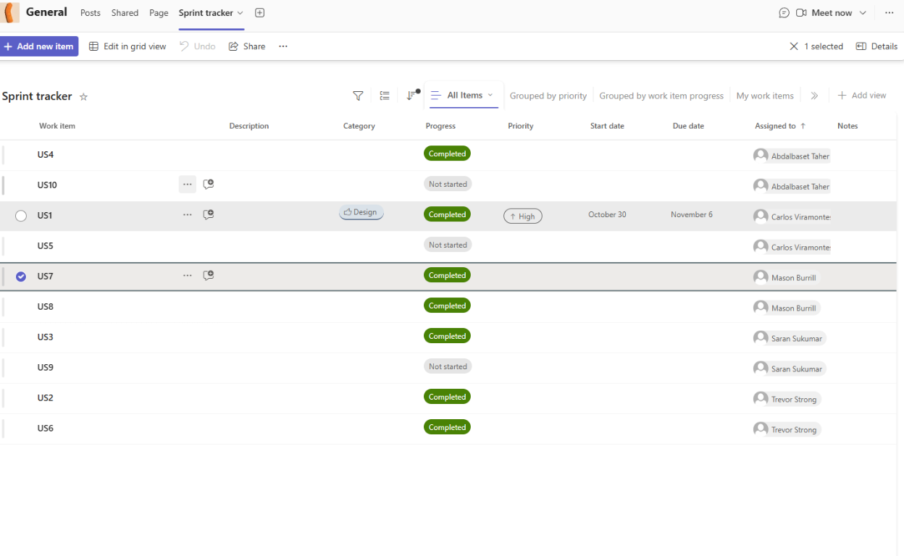

# Sprint 2 Review

**Date/time:**11/10

**Participants:** Carlos, Mason, Trevor, Saran, Abdal

## Sprint goal review

The README planned US4, US6, and US7 for Sprint 2. US4 was implemented and manually tested on 2026-11-06, before the recorded US6 and US7 merges. The README was not updated to reflect that scope change.

## Evidence-based outcome

| Story / deliverable | Repository evidence | Review status |
|---|---|---|
| US4 — Reserve portions | Implementation merged 2026-11-06. Manual-test records dated 2026-11-06 report criteria 1–3 passed; the simultaneous-last-portion scenario was not run by hand. | Implementation and partial manual evidence are present. No deployed review or Product Owner acceptance is recorded. |
| US6 — My reservations | Implementation merged 2026-11-10. Manual-test records dated 2026-11-10 report all three listed criteria passed. | Implementation and manual-test evidence are present. No deployed review or Product Owner acceptance is recorded. |
| US7 — Confirm pickup | Implementation merged 2026-11-12. | Implementation is present, but no US7 manual-test result or Product Owner acceptance is recorded. |
| Earlier-story retests | The 2026-11-10 manual-test file records US1, US2, and US3 criteria as passed. | Evidence for those listed checks is present; the repository does not show a Sprint 2 retest of US8. |
| Sprint board | A screenshot of the team's sprint tracker is saved as `board.png`. It shows US4, US1–US3, and US6–US8 completed, while US5 and US10 were not started. | Screenshot evidence is present; the single snapshot does not establish how the board changed throughout the sprint. |

## Review decisions and follow-up

- Review-meeting minutes, demo notes, attendee list, and Product Owner feedback are not in the repository; no acceptance decision is inferred.
- Add and record manual results for all US7 acceptance criteria, including invalid, wrong-vendor, used/cancelled code, and ended-window cases.
- Record any remaining re-tests and verify acceptance criteria in the Docker Compose deployment before release.
- Keep the sprint tracker current and capture board progress at multiple points in future sprints.

