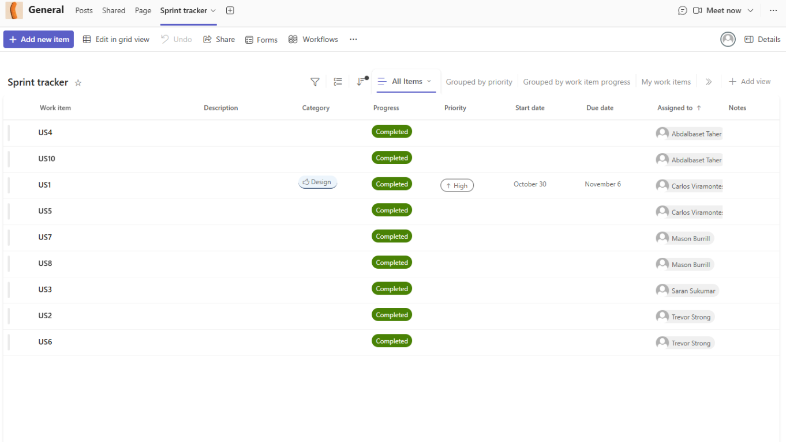

# Sprint 3 Review

**Date/time:** No review meeting date or time is recorded in the repository.

**Participants:** Not recorded.

## Evidence-based outcome

| Story / deliverable | Repository evidence | Review status |
|---|---|---|
| US5 — Manage listings | Implementation is present. `tests/test_us5_manage_listings.py` covers listing statuses/counts, editing, reservation limits, cancellation, and vendor ownership. The manual-test log records these checks as passed on 2026-11-13. | Implementation and focused test evidence are present. A Sprint 3 demo or Product Owner acceptance is not recorded. |
| US9 — Impact dashboard | Optional backlog story; explicitly excluded from the project plan. | Not planned or implemented. |
| US10 — Rate a pickup | Rating routes, model, and UI are present. `tests/manual-tests.md` records rating submission, single-rating/status rules, and vendor averages/comments as passed on 2026-11-14. | Implementation and manual-test evidence are present. The 300-character limit was not tried by hand; a Sprint 3 demo or Product Owner acceptance is not recorded. |
| Black-box test | The Selenium US2 scenario passed against the Compose web app and PostgreSQL on 2026-11-15. The standard suite also passed with 30 tests and this opt-in browser test skipped. | Browser test passed; full standard-suite run passed. |
| Sprint board | A screenshot of the team's sprint tracker is saved as `board.png`. It shows US1–US8 and US10 completed, while US9 was not started. | Screenshot evidence is present; the single snapshot does not establish how the board changed throughout the sprint. |

## Review decisions and follow-up

No review-meeting minutes or Product Owner decision are available, so no
acceptance decision is inferred. Confirm the release plan and burndown with
the team. Keep the sprint tracker current and capture its progress at multiple
points in future sprints.

